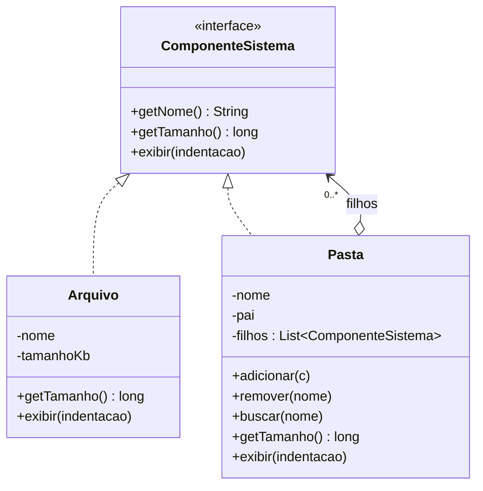

# Simulador de Sistema de Arquivos — Padrão Composite

Projeto da disciplina **Análise e Projeto de Sistemas II** (UNIPÊ).
Padrão de projeto escolhido: **Composite** (estrutural, GoF).

## 1. Explicação do projeto

Aplicação de terminal em Java que simula um sistema de arquivos simples, com **pastas** e **arquivos**.
Uma pasta pode conter arquivos e também outras pastas, em qualquer nível de profundidade.

O sistema permite:

| Comando | O que faz |
|---|---|
| `mkdir <nome>` | cria uma pasta |
| `touch <nome> <kb>` | cria um arquivo com tamanho em KB |
| `rm <nome>` | remove arquivo ou pasta (com todo o conteúdo) |
| `ls` | lista o conteúdo da pasta atual |
| `tree` | exibe a árvore completa a partir da pasta atual |
| `size [nome]` | calcula o tamanho total de um item ou da pasta atual |
| `cd <nome>` / `cd ..` | navega entre pastas |

O ponto central: **`size` e `tree` funcionam do mesmo jeito para um arquivo ou para uma pasta com milhares de itens**,
sem nenhum `if` perguntando "isto é arquivo ou pasta?".

### Como executar

Requer Java 17 ou superior.

```bash
javac -d out src/composite/*.java
java -cp out composite.Main
```

### Estrutura

```
src/composite/
├── ComponenteSistema.java   // Component (interface)
├── Arquivo.java             // Leaf
├── Pasta.java               // Composite
└── Main.java                // Client (terminal)
```

### Diagrama de classes



### Mapeamento do padrão

| Papel no GoF | Classe |
|---|---|
| Component | `ComponenteSistema` |
| Leaf | `Arquivo` |
| Composite | `Pasta` |
| Client | `Main` |

## 2. Justificativa do padrão

### Por que o Composite é o mais adequado?

O problema tem duas características que são exatamente o cenário do Composite:

1. **Estrutura hierárquica (parte-todo):** uma pasta contém arquivos *e outras pastas*.
2. **O cliente quer tratar o objeto individual e o grupo da mesma forma:** calcular tamanho e exibir
   devem funcionar igual para um `Arquivo` e para uma `Pasta`.

Sem o padrão, o código teria de verificar o tipo a cada passo:

```java
long tamanho(Object item) {
    if (item instanceof Arquivo a) return a.getTamanho();
    long total = 0;
    for (Object filho : ((Pasta) item).getFilhos()) total += tamanho(filho);
    return total;
}
```

Com o Composite, essa lógica some do cliente: `Pasta.getTamanho()` delega recursivamente para cada filho
e `Arquivo.getTamanho()` simplesmente retorna seu valor. Novos tipos de componente (ex.: `Atalho`, `ArquivoCompactado`)
entram sem alterar o código existente.

### Outros padrões que poderiam ser usados?

- **Iterator:** serviria para *percorrer* a árvore, mas não resolve como *representá-la*.
  Complementa o Composite (poderia ser usado para implementar o `tree`).
- **Visitor:** permitiria adicionar novas operações (contar arquivos, buscar por extensão) sem mexer nas classes,
  mas ainda precisaria de uma estrutura em árvore por baixo, que é o Composite.
- **Decorator:** tem estrutura parecida (objetos que envolvem outros objetos), mas a intenção é outra:
  *adicionar comportamento* a um objeto, não representar uma hierarquia com vários filhos.
- **Interpreter:** costuma usar Composite internamente para a árvore sintática; seria exagero para este problema.

Conclusão: o Composite é o padrão principal; Iterator e Visitor seriam complementos naturais em uma evolução do projeto.

## 3. Princípios SOLID aplicados

- **S — Responsabilidade única:** `Arquivo` só cuida de dados de arquivo; `Pasta` só cuida de gerenciar filhos; `Main` só cuida da interação com o usuário.
- **O — Aberto/fechado:** para criar um novo tipo (ex.: `Atalho`), basta implementar `ComponenteSistema`. `Pasta` e `Main` não mudam.
- **L — Substituição de Liskov:** em qualquer lugar que se espera um `ComponenteSistema`, é possível usar `Arquivo` ou `Pasta` sem quebrar o comportamento.
- **I — Segregação de interfaces:** `adicionar`, `remover` e `buscar` ficam **apenas em `Pasta`**, e não em `ComponenteSistema`. Assim `Arquivo` não é obrigado a implementar métodos que não fazem sentido para ele (versão "segura" do Composite).
- **D — Inversão de dependência:** `Pasta` guarda `List<ComponenteSistema>` (abstração), nunca depende das classes concretas `Arquivo` ou `Pasta` para seus filhos.

## 4. Possíveis evoluções

- Persistir a árvore em arquivo (JSON).
- Comando `find` usando Visitor.
- Atalhos e arquivos compactados como novos componentes.
